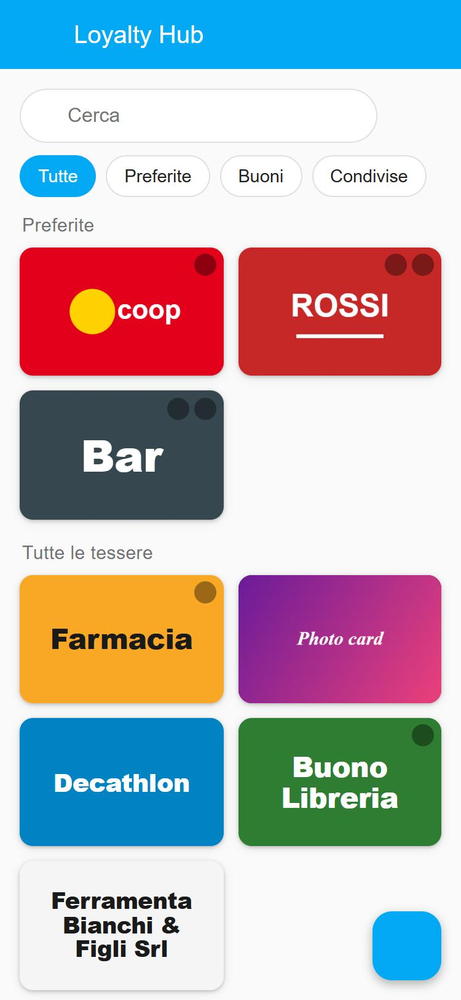

# Loyalty Hub

A Home Assistant integration for the **loyalty cards and vouchers** of the whole household: a sidebar panel, a Lovelace card, a notification when you walk into a shop and expiry reminders. Everything stays in your Home Assistant.

> **Status: beta (0.7.0).** It has been tested on a single installation so far, and some parts not yet (see below). Bug reports and feedback are very welcome. *Versione italiana più sotto.*

<p align="center">
  
</p>

## Features

- **Cards and vouchers** with barcode (CODE_128, EAN_13, QR_CODE, PDF_417, …), color, logo, notes, points and expiry. Vouchers keep a balance with every top-up and expense.
- **Add a card fast**: scan the barcode with the camera (HTTPS needed) or from a photo, with a guided flow and a shop list.
- **Cashier mode**: full-screen barcode to show at the till; the card is marked as used automatically.
- **Sharing and privacy**: every card is private, shared with chosen users or with everyone. Private cards are invisible to the other users, **administrators included** (an admin-only "see everything" option exists and warns the users).
- **Logos**: from [Logo.dev](https://www.logo.dev/) (free key recommended), the shop's website or logoapi.sh; or your own photo, cropped in the browser. "Color from logos" sets the card colors.
- **Merged cards**: cards of the same shop (for example yours and your partner's) become one tile with tabs; merge, split, order and name the groups as you like.
- **Near you**: cards linked to HA zones or saved places come first when you are there; optional notification when you enter the zone (at most once every 4 hours per card).
- **Expiry reminders** at 9:00 and the sensor `sensor.loyalty_hub_expiring_vouchers` (count only).
- **Cards for other people**: create a card for another user or transfer it; they get one grouped notification.
- **Optional features** the admin turns on (all off by default), each user can turn them off for themselves: open a card with an NFC tag, shopping list (`todo` entity) for a shop, "did you use your card?" reminder, points history chart, points expiry, default sharing, manual list order, low voucher balance, find a card from its barcode, high-contrast cashier mode.
- **Import / export**: Catima (zip), CSV; import from Wallet-Assistant.
- **17 languages** in the interface (some translations still need a native speaker's review: pl, cs, hu, el, ro, tr).

## Installation

### HACS (custom repository)
1. HACS → ⋮ menu → *Custom repositories* → add `https://github.com/notsirc/ha-loyalty-hub`, type *Integration*.
2. Install **Loyalty Hub** and restart Home Assistant.

### Manual
1. Copy `custom_components/loyalty_hub` into `<config>/custom_components/loyalty_hub`.
2. Restart Home Assistant.

### Setup
*Settings → Devices & services → Add integration → Loyalty Hub*. The setup suggests a free Logo.dev key (one per household) for better logos; you can skip it. In the **Options** you can change the logo services, the price comparison sites (`Name|https://site/search?q={query}`, one per line) and the days of notice before an expiry.

After an update, if the panel or the card look old in the Companion app, clear the frontend cache (Companion app → Settings → Troubleshooting).

## Lovelace card

```yaml
type: custom:loyalty-hub-card
mode: auto          # auto (default) | all | favorites | nearby
max_items: 6
show_selector: true # buttons [Auto] [All] [⭐] [📍] under the title
```

`auto` shows the cards near you first, then the favorites, then the most used ones (the same order as the panel). Turn `show_selector` off for fixed dashboards, such as a wall tablet.

## Privacy

- Cards are stored in Home Assistant (`.storage/loyalty_hub.data`) and logos in `<config>/loyalty_hub/`. Nothing is sent to the author or to any cloud of this project.
- External services are contacted only to look up a logo (Logo.dev, the shop's website, logoapi.sh) and only when you or the automatic logo search ask for it. Price comparison links open in your browser.
- Notifications go only to the users who can see the card.

## Tested so far

Android Companion app: panel, scanner, find by code, merged cards, NFC, shopping list, Lovelace card. **Not tested yet**: NFC on iOS, zone notifications (also the "N items on your list" line), the 0.7.0 changes on a real phone. Reports are welcome.

## Development

```bash
python -m pytest tests -q                 # pure logic tests (core/, no Home Assistant needed)
cd frontend && npm ci && npm run build    # panel and card (TypeScript + Lit)
npm run typecheck && npm run i18n:check
```

`frontend/dev/index.html` is a mock of Home Assistant with fake users (Alice, Bob, Carol) to try the interface in a browser: serve the repository root (for example `python -m http.server`) and open `/frontend/dev/index.html`.

## Credits

Inspired by [Wallet-Assistant](https://github.com/myTselectionPublic/Wallet-Assistant) (itself based on Card Wallet), a loyalty card wallet for Home Assistant. Loyalty Hub is a separate project written from scratch; a few lines of its import code come from Wallet-Assistant (MIT), see [THIRD_PARTY_NOTICES.md](THIRD_PARTY_NOTICES.md).

## License

[MIT](LICENSE)

---

## Italiano

**Loyalty Hub** raccoglie le **tessere fedeltà e i buoni** di tutta la famiglia in Home Assistant: pannello nella barra laterale, card Lovelace, notifica quando entri in un negozio e avvisi di scadenza. I dati restano nel tuo Home Assistant.

- **Stato:** beta (0.7.0). Segnalazioni e suggerimenti sono benvenuti nelle *Issues*.
- **Installazione:** HACS → ⋮ → *Repository personalizzati* → `https://github.com/notsirc/ha-loyalty-hub`, categoria *Integrazione*; poi riavvia HA e aggiungi l'integrazione da *Impostazioni → Dispositivi e servizi*. In alternativa copia `custom_components/loyalty_hub` a mano.
- **Logo.dev:** la configurazione consiglia una chiave gratuita (una per casa) per avere loghi migliori; si può saltare.
- **Privacy:** le tessere private non le vede nessun altro, nemmeno gli amministratori (salvo l'opzione "l'admin vede tutto", che avvisa gli utenti). Servizi esterni solo per cercare i loghi.
- **Funzioni facoltative** (NFC, lista della spesa, storico punti, …): le accende l'amministratore nel pannello → Impostazioni → Amministrazione → Funzioni.
- Dopo un aggiornamento, se nell'app Companion vedi ancora la versione vecchia, svuota la cache del frontend.
